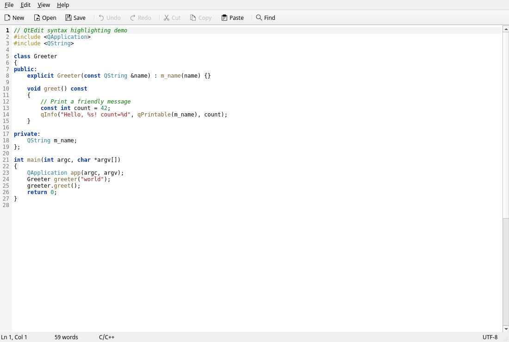
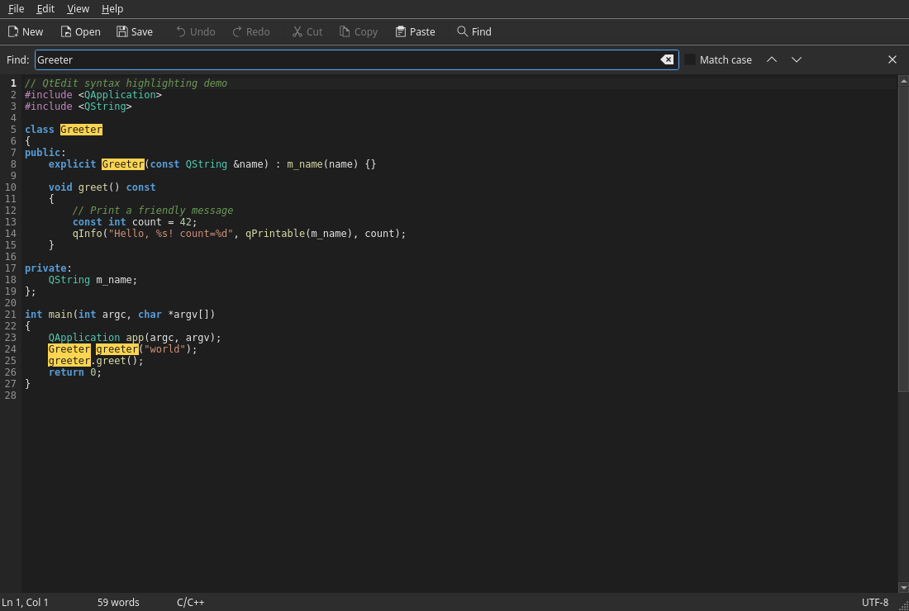

# QtEdit

A small, fast text editor built with **Qt 6** and **C++17**.



## Features

- Line numbers with current-line highlighting
- Syntax highlighting for C/C++, Python, JSON, and shell scripts
- Find bar with match-case, highlight-all, next/previous, and wrap-around
- Auto-indent, automatic brace dedent, and spaces-based tab indentation
- Light and dark themes that are applied instantly
- Configurable editor font, zoom in/out, and a distraction-free full-screen mode
- Word wrap and line-number toggles
- Go to line, editable recent-files list, and drag-and-drop file opening
- Command-line file argument, e.g. `qtedit notes.txt`
- Settings persisted with `QSettings`
- Atomic saves with `QSaveFile`, UTF-8 by default, and UTF-8 BOM preservation



## Install

The installer is distro-agnostic. It detects the available package manager,
offers to install any missing build dependencies, builds QtEdit, and
integrates it with the desktop.

```bash
./install.sh
```

By default it installs for the current user under `~/.local`:

| Item | Location |
| --- | --- |
| Launcher | `~/.local/bin/qtedit` |
| Menu entry | `~/.local/share/applications/qtedit.desktop` |
| Icons | `~/.local/share/icons/hicolor/{16..512,scalable}/apps/` |
| AppStream metadata | `~/.local/share/metainfo/` |
| Uninstaller | `~/.local/bin/qtedit-uninstall` |

The installer registers the menu entry, installs eight PNG icon sizes plus an
SVG, refreshes the desktop and icon caches, and declares associations for
plain text, Markdown, C/C++, Python, shell scripts, and JSON. It sets
`QGuiApplication::setDesktopFileName()` so Wayland compositors associate the
window with the menu entry.

System-wide installation uses `sudo` only for the final copy:

```bash
./install.sh --system          # installs under /usr/local
sudo ./install.sh --uninstall  # remove the system-wide copy
```

Other options:

```bash
./install.sh --prefix /opt/qtedit   # custom prefix
./install.sh --no-build             # reuse an existing build/qtedit
./install.sh --no-deps              # never install packages
./install.sh -y                     # non-interactive dependency install
./install.sh --uninstall            # remove the per-user installation
```

Supported dependency installers include `apt`, `dnf`, `pacman`, `zypper`,
`apk`, `xbps-install`, `eopkg`, and `emerge`. On NixOS the installer prints
the equivalent `nix-shell` command.

### Self-contained AppImage

Build a portable AppImage that bundles Qt and its plugins:

```bash
./packaging/build-appimage.sh
./install.sh --appimage dist/QtEdit-1.0.0-x86_64.AppImage
```

The AppImage can also be run directly:

```bash
./dist/QtEdit-1.0.0-x86_64.AppImage
```

Installing an AppImage extracts it under `~/.local/share/qtedit/app` and
creates the same menu entry, icons, launcher, and uninstaller as a source
installation. This avoids a runtime dependency on FUSE.

**Portability note:** an AppImage inherits the glibc baseline of the machine
that built it. A locally built image therefore runs on that distro and newer
ones, not on older releases. The included GitHub Actions workflow
(`.github/workflows/appimage.yml`) builds on Ubuntu 22.04 (glibc 2.35, Qt 6.2),
which covers Debian 12, Ubuntu 22.04+, Fedora 36+, and newer rolling distros.
For older systems, use the source installer on the target machine.

### Uninstall

```bash
qtedit-uninstall
# or
./install.sh --uninstall
```

## Requirements

- Qt 6.2 or newer (tested with Qt 6.12)
- CMake 3.16 or newer
- A C++17 compiler

`./install.sh` can install these for you. To do it manually:

```bash
# Debian / Ubuntu
sudo apt install build-essential cmake qt6-base-dev

# Arch Linux
sudo pacman -S base-devel cmake qt6-base

# Fedora
sudo dnf install gcc-c++ cmake qt6-qtbase-devel
```

## Build and run manually

```bash
cmake -S . -B build -DCMAKE_BUILD_TYPE=Release
cmake --build build -j"$(nproc)"
./build/qtedit README.md
```

The CMake install rules are also available for packagers:

```bash
sudo cmake --install build --prefix /usr/local
```

## Keyboard shortcuts

| Shortcut | Action |
| --- | --- |
| `Ctrl+N` | New file |
| `Ctrl+O` | Open file |
| `Ctrl+S` | Save |
| `Ctrl+Shift+S` | Save as |
| `Ctrl+Q` | Quit |
| `Ctrl+Z` / `Ctrl+Shift+Z` / `Ctrl+Y` | Undo / Redo |
| `Ctrl+X`, `Ctrl+C`, `Ctrl+V` | Cut, copy, paste |
| `Ctrl+F` | Show find bar |
| `F3` / `Shift+F3` | Find next / previous |
| `Ctrl+G` | Go to line |
| `Ctrl+Alt+W` | Toggle word wrap |
| `Ctrl+=` / `Ctrl+-` / `Ctrl+0` | Zoom in / out / reset |
| `Ctrl+Shift+=` | Zoom in (alternative) |
| `F11` | Toggle full screen |
| `Tab` / `Shift+Tab` | Indent / unindent selection |
| `Esc` | Close the find bar |

## Project layout

```text
qtedit/
├── CMakeLists.txt
├── install.sh                 Universal installer / uninstaller
├── qtedit.desktop
├── LICENSE
├── packaging/
│   ├── build-appimage.sh      Portable AppImage builder
│   └── io.github.gtedit.QtEdit.metainfo.xml
├── .github/workflows/
│   └── appimage.yml           Reproducible AppImage release build
├── resources/
│   ├── appicon.svg
│   └── icons/hicolor/         PNG icon sizes for desktop integration
└── src/
    ├── main.cpp               Application entry point
    ├── mainwindow.h/.cpp      Menus, toolbar, status bar, find, file handling
    ├── editor.h/.cpp          Editor widget, line numbers, indentation
    └── syntaxhighlighter.h/.cpp
```

## Notes

- Settings are stored in `~/.config/GtEdit/QtEdit.conf` on Linux.
- The editor is intentionally single-document; each window holds one file.
- Files are read and written as UTF-8. A UTF-8 BOM is detected and preserved.
- QtEdit is released under the MIT license (see `LICENSE`).
